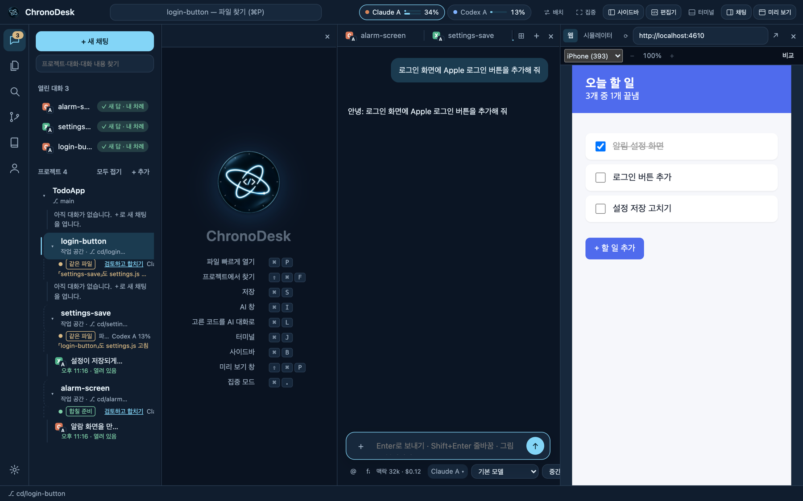
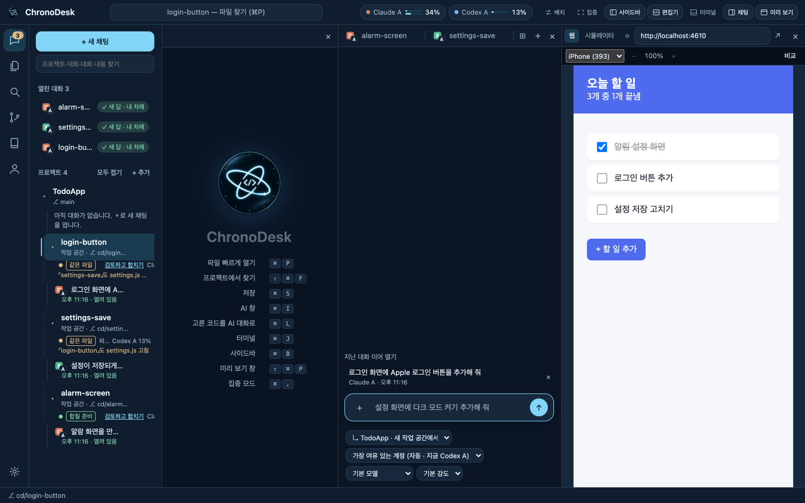
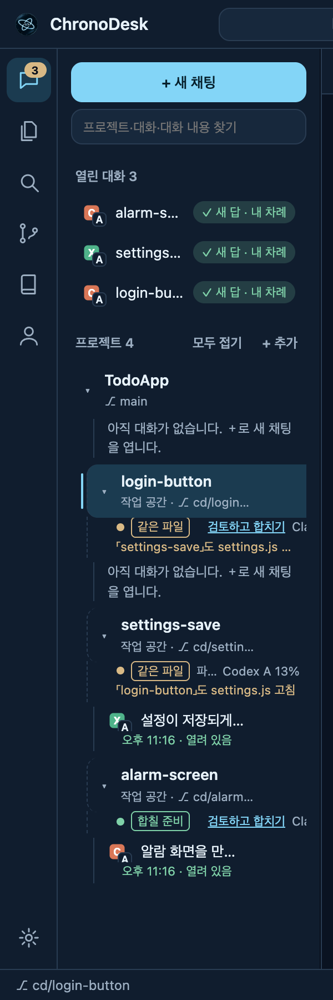
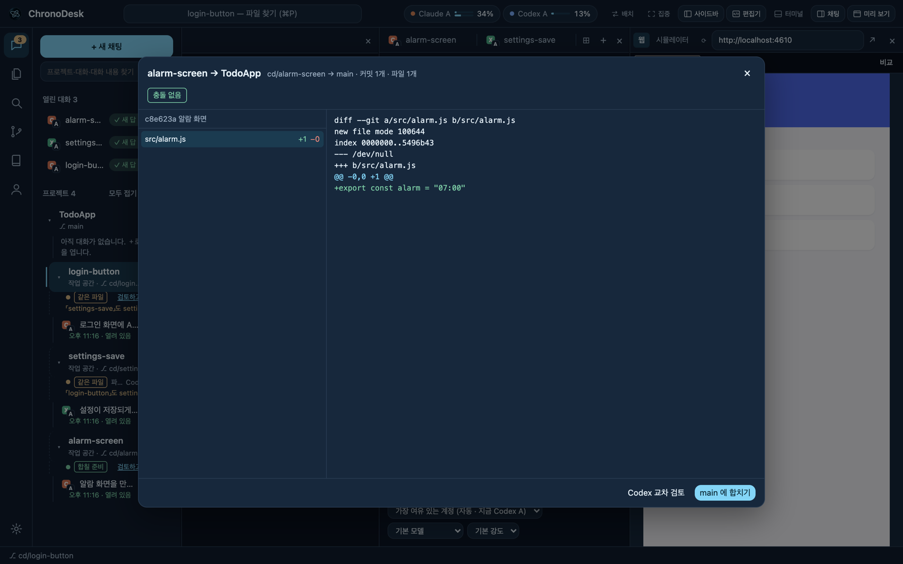
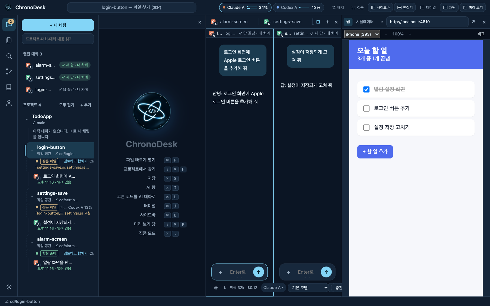
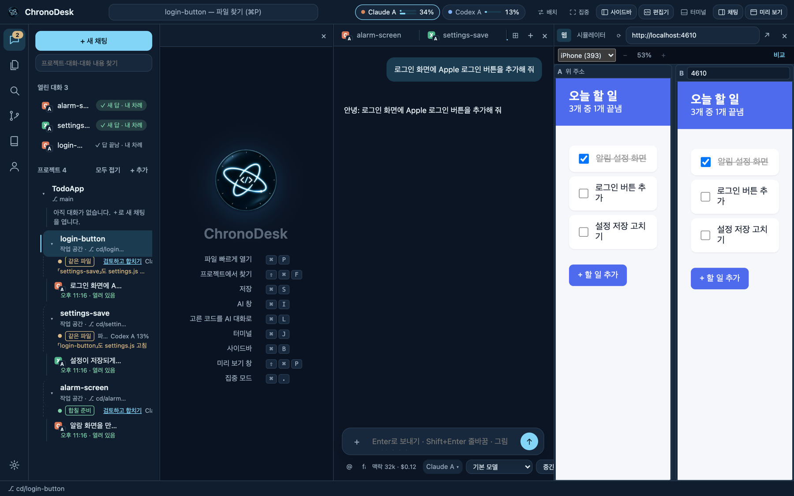

# ChronoDesk

**여러 Claude Code·Codex 계정을 한 창에서 쓰는 Mac 작업대**입니다(윈도우 시험판도 있습니다).
대화, 코드, 터미널, 웹·iOS 미리 보기가 한 화면에 있고, 같은 프로젝트를 여러 갈래(작업 공간)로 나눠 AI 여럿에게 동시에 맡길 수 있습니다.

> 베타입니다. 무료이고, 내 컴퓨터 안에서만 동작합니다. [English below](#english)

## 내려받기

1. 오른쪽 **Releases**에서 가장 위(Latest)의 `ChronoDesk-0.1.0-<빌드>-arm64.dmg`를 받습니다.
2. dmg를 열고 ChronoDesk를 **Applications** 폴더로 끌어다 놓습니다.
3. Launchpad나 Spotlight에서 ChronoDesk를 엽니다.

필요한 것
- Apple 실리콘(M1 이후) Mac
- [Claude Code](https://code.claude.com/docs/en/setup)나 Codex CLI 중 쓰려는 것. 없으면 첫 화면에 설치 명령이 나옵니다.
- 각 서비스의 본인 구독 계정. 로그인은 공식 프로그램의 로그인 화면에서 직접 합니다.

업데이트: 새 버전이 나오면 앱이 뒤에서 받아 두고 왼쪽 아래에 **「업데이트 준비됨」**이 뜹니다. 누르면 다시 켜지며 바뀝니다(대화 기록은 그대로). 지금 버전은 오른쪽 아래 **「빌드 N」**에서 봅니다.

### 윈도우 (시험판)

[Releases](https://github.com/JakeLim17/ChronoDesk-releases/releases)에서 **「윈도우 시험판」**(Pre-release)의 `ChronoDesk-0.1.0-<빌드>-win-x64.zip`을 받습니다. Windows 10/11 64비트(x64)용이고, 서명하지 않은 실험판입니다.

1. PowerShell에서 쓰려는 AI 프로그램을 설치합니다(관리자 권한 불필요).
   - Claude Code: `irm https://claude.ai/install.ps1 | iex`
   - Codex CLI: `powershell -ExecutionPolicy ByPass -c "irm https://chatgpt.com/codex/install.ps1 | iex"`
2. 새 PowerShell 창에서 `claude`나 `codex`를 실행해 로그인합니다.
3. zip을 풀고 `ChronoDesk.exe`를 실행합니다. 「Windows의 PC 보호」가 뜨면 「추가 정보」 → 「실행」.

윈도우에서는 Claude·Codex 연결까지 확인했고 나머지 기능은 확인 중입니다. 자동 업데이트가 없고, iOS 시뮬레이터 등 Mac 전용 기능은 동작하지 않습니다. 안 되면 계정 화면의 **「연결 진단」** 결과를 Issues에 남겨 주세요.

## 처음 10분 안내

### 1. 계정 추가하기
왼쪽 사람 모양 아이콘(계정) → **계정 추가** → Claude 또는 Codex를 고르고 이름을 붙입니다(예: 「회사」, 「개인」). 처음 열면 공식 로그인 화면이 뜨니 거기서 로그인하세요. 위쪽에 계정마다 사용량 막대가 보입니다.

### 2. 프로젝트 열기
왼쪽 **「+ 추가」**를 누르거나, Finder에서 폴더를 왼쪽 목록으로 끌어다 놓습니다.

### 3. 첫 대화
**「+ 새 채팅」** → 입력칸 아래에서 *어디서*(프로젝트)와 *어느 계정*으로 할지 고르고 할 일을 적어 보냅니다.
AI가 파일을 고치거나 명령을 실행하려 하면 먼저 묻습니다. 자주 묻는 게 번거로우면 입력칸 아래 허용 방식을 「자동」으로 바꿀 수 있습니다.

### 4. 미리 보기
오른쪽 미리 보기 창 주소칸에 개발 서버 포트(예: `3000`)를 적고 Enter. **iPhone·iPad·데스크톱** 크기로 바꿔 보고, 콘솔에서 오류를 봅니다. AI에게 「미리 보기에서 확인해 줘」라고 하면 AI가 직접 화면을 보고 눌러 봅니다.

### 5. 일을 나눠 동시에 맡기기 (작업 공간)
새 채팅에서 **「↳ 프로젝트 · 새 작업 공간에서」**를 고르면, 같은 저장소를 다른 폴더·브랜치(`cd/…`)로 하나 더 열어 그 안에서 대화합니다. 계정은 **「가장 여유 있는 계정 (자동)」**을 고르면 지금 쉬고 있고 사용량이 낮은 계정이 맡습니다.

왼쪽 목록에서 작업 공간마다 상태를 한눈에 봅니다: **진행 중 · 합칠 준비 · 커밋 전**, 쓰는 계정과 사용량, 바꾼 파일 수, 그리고 **두 작업 공간이 같은 파일을 고치면 미리 경고**합니다.

### 6. 검토하고 합치기
「합칠 준비」가 된 작업 공간의 **「검토하고 합치기」**를 누르면 커밋·바뀐 파일·차이와 **충돌 예상**을 보여 줍니다(계산만 하고 아무것도 바꾸지 않습니다). **「Codex 교차 검토」**를 누르면 다른 AI가 읽기 전용으로 검토하고, 괜찮으면 **「main 에 합치기」**.

### 7. 나란히 보기
AI 창 위 **⊞**로 대화 2~4개를 나란히 띄워 여러 작업 공간을 함께 지켜봅니다. 미리 보기의 **「비교」**는 두 주소(예: 두 작업 공간의 개발 서버)를 같은 기기 크기로 나란히 보여 줍니다.

## 주요 기능

- 여러 Claude·Codex 계정 한 창에서, 계정별 사용량 표시
- 대화: 선택지 카드, 메시지 고쳐 보내기, 대화 검색·내보내기, 자주 쓰는 지시 모음(`/`)
- 코드: 파일 탐색·편집기, 터미널, git 변경·커밋, diff 줄에 댓글 달아 AI에게 보내기, 외부 편집기로 열기
- 교차 리뷰: 한 AI가 만든 변경을 다른 AI가 읽기 전용으로 검토
- 병렬 작업 공간: 상태 한눈에 보기, 같은 파일 경고, 합치기 전 검토·충돌 예상
- 미리 보기: 웹(기기 크기·확대·콘솔), iOS 시뮬레이터 화면, AI가 직접 조작
- 연결이 끊겨도 저절로 다시 연결(Mac이 잠자기에서 깨어나면 바로)
- 한국어·English 화면, 테마 4개

## 개인정보와 약관

- ChronoDesk에는 자체 서버가 없고, 사용 기록을 밖으로 보내지 않습니다. 새 버전 확인만 이 저장소(GitHub)에 묻습니다(설정에서 끌 수 있음).
- 로그인 정보(토큰·키체인)를 읽거나 보내지 않습니다. 로그인은 공식 프로그램이 직접 처리합니다.
- 계정 정보와 대화 기록은 홈 폴더의 `.agent-accounts`에 저장됩니다.
- 여러 계정 기능은 **본인이 가진 계정**을 한 창에서 고르기 위한 것입니다. 한도를 피하려고 계정을 여러 개 만드는 것은 각 서비스의 약관에 어긋날 수 있습니다. 공개판은 한도에 닿아도 자동으로 계정을 바꾸지 않습니다.
- AI가 미리 보기 창의 외부 사이트 내용을 읽으려 하면 먼저 묻습니다.
- Claude·Claude Code는 Anthropic의, Codex·ChatGPT는 OpenAI의 상표입니다. ChronoDesk는 두 회사와 관계없는 개인 도구입니다.

## 자주 묻는 것

**「서버와 연결이 끊겼습니다」가 떠요.** 빌드 33부터는 저절로 다시 연결됩니다. 그 전 버전이면 최신으로 바꿔 주세요.
**업데이트 카드가 안 떠요.** 새 버전 확인은 몇 시간 간격입니다. 앱을 메뉴의 「ChronoDesk 종료」로 끄고 다시 켜면 바로 확인합니다. 빌드 27 이하는 dmg를 한 번 직접 받아 덮어 설치해야 합니다.
**지우려면?** Applications의 ChronoDesk를 휴지통으로. 기록까지 지우려면 홈 폴더의 `.agent-accounts`를 지웁니다.

문의·버그는 이 저장소의 **Issues**에 남겨 주세요.

---

## English

**ChronoDesk is a Mac workbench for using multiple Claude Code and Codex accounts in one window** — chats, code, terminal, and web/iOS previews side by side, plus parallel *workspaces* (git worktrees) so several AIs can work on the same project at once.

Beta. Free, runs only on your own computer. A Windows preview is also available (see below).

**Install:** download the latest `ChronoDesk-0.1.0-<build>-arm64.dmg` from **Releases**, drag ChronoDesk to **Applications**, and open it. Requires an Apple silicon Mac and Claude Code and/or Codex CLI with your own subscription (you sign in through the official tools). Updates download in the background; click **"Update ready"** at the bottom left to restart into the new version. The current build is shown at the bottom right.

**First 10 minutes:** add an account (person icon) → add a project (**+ Add** or drag a folder in) → **+ New chat**, pick where and which account → open your dev server in the preview (type a port such as `3000`) → for parallel work choose **"in a new workspace"** and **"Account with most room (auto)"** → when a workspace is **Ready to merge**, click **Review and merge** to see commits, diffs and likely conflicts, ask the other AI for a **cross-review**, then merge. Use **⊞** to watch 2–4 chats side by side and **Compare** to view two previews side by side.

**Privacy:** no ChronoDesk server; nothing about your usage is sent anywhere except checking this repository for new versions (can be turned off). ChronoDesk never reads or sends your sign-in tokens. Data lives in `~/.agent-accounts`. Use only accounts you own and follow each service's terms; the public build never switches accounts automatically. Claude is a trademark of Anthropic; Codex and ChatGPT are trademarks of OpenAI; ChronoDesk is an independent tool not affiliated with either.

**Windows (preview):** download `ChronoDesk-0.1.0-<build>-win-x64.zip` from the **Windows preview** pre-release under [Releases](https://github.com/JakeLim17/ChronoDesk-releases/releases) (Windows 10/11 x64, unsigned). Install Claude Code (`irm https://claude.ai/install.ps1 | iex`) and/or Codex CLI in PowerShell, sign in once by running `claude` or `codex`, then unzip and run `ChronoDesk.exe` (SmartScreen: "More info" → "Run anyway"). Connecting to Claude and Codex has been confirmed on Windows; other features are still being tested. No auto-update; Mac-only features such as the iOS simulator are unavailable. If something fails, please attach the **Connection check** output from the Accounts screen to an Issue.

Questions or bugs: please open an **Issue**.
